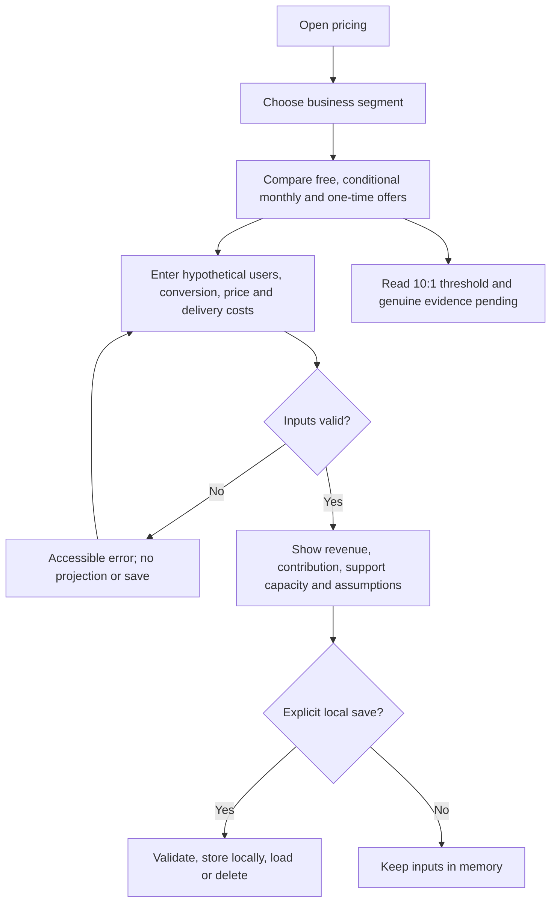
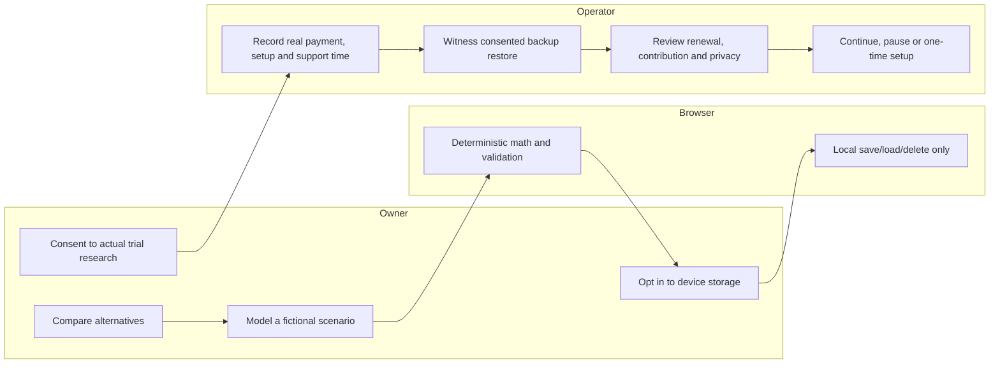

# Cyber Shield MX · Week 14 packet
Prepared 2026-11-15 before Week 14 implementation. Source of truth: supplied BLUEPRINT_team2_ week 14 FINAL.pdf. Existing Week 8/13 reviewed; current Week 14 repository empty. This packet is published before source changes.

## Problem, exact user, payer
Mexican small-business owners without dedicated security staff can read free guidance but may not follow through on a recurring continuity routine. Owner pays, not employees. Segment A: owner-operated 1–5 people, usually self-service; segment B: 6–25 people, a designated responsible person and bounded review. Both retain the full free essentials. No observed demand or measured 10:1 result exists.

## Success before the module closes
/pricing explains three offers, two segments, exclusions and the free boundary. Simulator accepts users, conversion and price; shows monthly/annual gross revenue plus fully costed contribution and capacity assumptions. Explicit opt-in local scenario saving supports load/delete and survives reload. /about publishes the one-page 10:1 memo with all assumptions marked. Preserve the previous planner and optional local AI. Automated checks and live route checks pass. Publish at least five meaningful commits and two deployments. Genuine payer interview, witnessed restore and renewal remain pending until performed by humans.

## Offer and stop rules
Free guide MXN 0: essential educational plan and simulator. Conditional pilot MXN 299/month per business: bounded monthly review/follow-through; proposed, unavailable for purchase in this demo. One-time setup MXN 599 is an unvalidated fallback hypothesis, no automatic switch or checkout. Licenses, backup storage, incident response, SOC, monitoring and protection guarantees excluded. Ten-business trial; measure onboarding, acquisition, review, corrections, exceptions, support and actual paid renewal. Target support <=15 minutes per account/month. Require positive fully costed contribution and feasible capacity. Pause or narrow trial if witnessed restore is missing, privacy/protection fails, or economics fail. Switch to one-time setup if repeat value or renewal/support thresholds fail. Three genuine paid commitments is a test threshold, never proof of recurring demand.

## Image-generated mockup

One built-in image-generation call requested before code; provenance saved alongside image. Concept is not a screenshot or observed outcome.

## Feature flow

## Benchmark and research
The strongest reviewed managed-security benchmark is Huntress, whose pricing page includes 24/7 SOC expertise; it is a comparator, not an equivalent offer or a claim of objectively universal best (https://www.huntress.com/pricing, checked 2026-11-15). Cyber Shield localizes a much narrower Spanish continuity follow-through experiment with transparent MXN hypotheses; it does not supply a SOC. Credible free substitute: UK NCSC Small Business Guide (https://www.ncsc.gov.uk/collection/small-business-guide), plus a notes/spreadsheet checklist. No foreign price proves Mexican demand.

## Three-year light charter
If validated, Cyber Shield becomes a bounded continuity workflow for small Mexican businesses with accountable task completion. Consent, evidence of restore and honest unknowns remain foundational. Expand only after measured renewal, feasible delivery and positive contribution, rather than adding surveillance or fear-based sales.

## Security and evidence boundaries
No checkout, accounts, backend, credentials, uploaded backups, or personal research data. Store only validated simulator numbers and a fixed scenario identifier with explicit consent; do not ask for business names. Show device privacy and delete controls. AI does not set prices or make security decisions. Preserve full available user/assistant transcript with a tool evidence index, excluding secrets and internal instructions; never reconstruct unavailable prior assistant messages.
